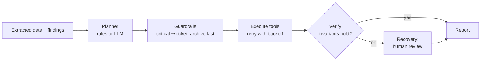

# Intelligent Document Processing with NLP and Agentic AI

[](https://github.com/YOUR_USERNAME/idp-agent/actions)


A system that **reads technical documents** (text, PDF, scanned images), **extracts structured data**,
**verifies it** against engineering rules, and lets an **agent decide and trigger actions**
(open a ticket, send an alert, queue a human review, archive) before producing a **report**.

It works **fully offline by default** (deterministic rule-based agent) and can optionally let an
**LLM choose the actions**, with guardrails that keep the behaviour safe even when the model is wrong.

```text
 PDF / image / text ──► ingestion ──► NLP extraction ──► verification ──► agent ──► report + actions
                        (pypdf, OCR)  (rules, spaCy)      (rule engine)   (plan → act → verify)
```

## Why this project

| Skill | Where to look |
|---|---|
| Applied NLP (bilingual EN/FR) | `extraction.py`, `vocabulary.py`, `entities.py` (optional spaCy NER) |
| OCR & document ingestion | `ingestion.py` (PDF text layer, scanned PDF, Tesseract) |
| Agentic AI (planning, tools, guardrails, retries, verification) | `agent.py`, `planner.py`, `tools.py` |
| LLM integration done safely | `llm.py`, `LLMPlanner` (schema-validated, falls back to rules) |
| Evaluation | `evaluation.py` — precision / recall / F1 against ground truth |
| API & engineering practices | FastAPI service, typed code, 94 tests, CI, Docker, linting |

## Quick start

Requirements: **Python 3.10+** and the **Tesseract** binary for OCR
(`sudo apt install tesseract-ocr tesseract-ocr-fra` · `brew install tesseract tesseract-lang` ·
[Windows installer](https://github.com/UB-Mannheim/tesseract/wiki)). Text and PDF files work without it.

```bash
git clone https://github.com/YOUR_USERNAME/idp-agent.git
cd idp-agent
python -m venv .venv
source .venv/bin/activate            # Windows PowerShell: .venv\Scripts\Activate.ps1
pip install -e ".[dev]"

idp generate-samples                 # synthetic documents + ground truth in data/
idp process data/samples -o output   # run the whole pipeline
idp evaluate data/samples            # measure extraction quality
```

Example console output:

```text
🔴 maintenance_report_critical_en.txt: 2 finding(s); actions: create_ticket, send_alert, request_human_review, archive_document
🟠 maintenance_incomplete_en.txt: 3 finding(s); actions: request_human_review, archive_document
🟢 datasheet_pump_en.txt: 0 finding(s); actions: archive_document
```

A full example report is in [`docs/example_report.md`](docs/example_report.md). Everything the agent
did is written under `output/`:

```text
output/
├── reports/<file>.md | .json      # human-readable report + structured result
└── actions/
    ├── tickets/TCK-XXXXXXXX.json  # one file per ticket
    ├── alerts.jsonl               # simulated notification outbox
    ├── review_queue.jsonl         # documents waiting for a human
    └── archive.jsonl              # processing log
```

## Usage

### Command line

```bash
idp process FILE_OR_FOLDER... [-o OUTPUT_DIR] [--llm none|anthropic]
idp evaluate data/samples [--min-f1 0.95]    # exit code 1 if F1 is below the threshold
idp generate-samples [-d data]
idp serve [--host 127.0.0.1] [--port 8000]   # REST API, see below
```

### REST API

```bash
pip install -e ".[api]"
idp serve                      # interactive docs: http://127.0.0.1:8000/docs
```

```bash
curl -F "file=@data/samples/maintenance_report_critical_en.pdf" http://127.0.0.1:8000/process
curl -X POST http://127.0.0.1:8000/process/text \
     -H "Content-Type: application/json" \
     -d '{"text": "Maintenance report\nEquipment: Pump P-1\n- Measured pressure: 18 bar\n- Maximum pressure: 16 bar"}'
curl http://127.0.0.1:8000/health
```

Uploads are limited by type and size (`IDP_MAX_UPLOAD_MB`); the client file name is never used as a path.

### Docker

```bash
docker build -t idp-agent .
docker run -p 8000:8000 -v "$PWD/output:/data/output" idp-agent
```

### Optional: spaCy entities

```bash
pip install -e ".[nlp]"
python -m spacy download en_core_web_sm fr_core_news_sm
```

When a model is installed, organisations, people and places are added to the extracted entities.
Without it the pipeline simply skips this step.

### Optional: let an LLM choose the actions

```bash
pip install -e ".[llm]"
export ANTHROPIC_API_KEY=sk-...          # PowerShell: $env:ANTHROPIC_API_KEY="sk-..."
idp process data/samples --llm anthropic
```

The model sees only the **structured** extraction and findings (never the raw document text, which
limits prompt injection). Its answer is parsed and every action is validated against the tool schemas.
If it fails or answers badly, the rule-based planner takes over. See
[`docs/ARCHITECTURE.md`](docs/ARCHITECTURE.md).

## How the agent works



| Capability | Implementation |
|---|---|
| **Plans** | `RulePlanner` (policy) or `LLMPlanner` (model proposes a JSON action list) |
| **Uses tools** | `create_ticket`, `send_alert`, `request_human_review`, `archive_document` — JSON-schema validated |
| **Verifies** | A critical finding without a ticket is detected after execution |
| **Handles errors** | Transient failures retried with exponential backoff; invalid calls rejected without retry; a failed ticket triggers a human-review fallback |
| **Adapts** | Different findings produce different action plans; a bad LLM answer degrades to rules |

The default tools write files so that the project runs anywhere. To connect Jira, e-mail or Slack,
replace the handlers in `tools.py` — the agent only depends on the `Tool` contract.

## Verification rules

| Rule | Severity | Example |
|---|---|---|
| `limits` — measured value vs max/min (units converted: bar/psi/MPa, V/kV, W/kW) | critical | 18.2 bar measured, 16 bar maximum |
| `reported_issue` — anomaly described in the text, negations ignored | warning | "Leak detected at the discharge flange" |
| `required_fields` — id, date, equipment, document type | warning | missing document ID |
| `plausible_ranges` — physically impossible values (typical OCR errors) | warning | 12000 °C |
| `date_sanity` | warning | document dated in the future |
| `standards` | info | datasheet citing no ISO/IEC/EN standard |

Add a rule by writing a function `ExtractedDocument -> list[Finding]` and adding it to `DEFAULT_RULES`.

## Evaluation

`idp evaluate` compares the output with `<name>.expected.json` ground truth.
Results on the bundled **synthetic** data (5 fictional documents; 8 files because some exist as
`.txt`, `.pdf` and `.png` scan):

| Set | Files | Field accuracy | Measurements P / R / F1 | Severity | Actions |
|---|---|---|---|---|---|
| `data/samples` (typical layouts) | 8 | 100 % | 100 / 100 / 100 % | 100 % | 100 % |
| `data/samples_hard` (stress set) | 2 | 100 % | 100 / 28.6 / 44.4 % | 50 % | 50 % |

**Read these numbers honestly.** The main set was written together with the rules, so 100 % is a
regression test and a demonstration, not a claim of real-world accuracy. The stress set is the
more informative one: it shows where the approach breaks (below). To get a real accuracy figure,
add *your own* public documents to a folder together with `.expected.json` files and run `idp evaluate`.

## Limitations

* **Layout assumptions.** Measurements are read from `label: value unit` lines. Values inside tables
  (`Pressure   210 bar   200 bar`) or narrative sentences ("a surface temperature of 135 °C") are missed —
  this is exactly what `data/samples_hard` measures.
* **Keyword-based anomaly detection** with simple negation handling; irony, long-range negation or
  domain jargon outside `vocabulary.py` are not understood.
* **OCR quality** depends on scan quality; the demo image is a clean render. Only English is installed
  by default in some Tesseract builds — the code falls back to English if the French pack is missing.
* Limits are compared only when parameter and (convertible) unit match; other units are skipped.
* The bundled tools **simulate** ticketing/alerting by writing files.
* English and French only.

## Roadmap

1. Table extraction (pdfplumber / camelot) and sentence-level measurement extraction with spaCy `Matcher`.
2. LLM extraction fallback when confidence is low, validated by the same rule engine.
3. Real connectors (Jira, SMTP, Slack) and a human-review UI.
4. Larger annotated benchmark from public datasheets and standards.

## Project structure

```text
src/idp_agent/
├── ingestion.py     # txt / pdf / image → text (OCR)
├── extraction.py    # text → ExtractedDocument (rules, bilingual)
├── entities.py      # optional spaCy NER enrichment
├── validation.py    # verification rules
├── planner.py       # RulePlanner, LLMPlanner
├── agent.py         # plan → guardrails → act (retry) → verify → recover
├── tools.py         # tool registry + default tools
├── llm.py           # LLM client abstraction (Anthropic)
├── reporting.py     # Markdown report
├── pipeline.py      # orchestration + output writing
├── evaluation.py    # P/R/F1 against ground truth
├── samples.py       # synthetic documents + ground truth
├── api.py           # FastAPI service
└── cli.py           # `idp` command
tests/               # 94 tests (pytest)
docs/                # architecture notes, example report, French guide
```

## Development

```bash
make install     # pip install -e ".[dev]"
make test        # pytest with coverage
make lint        # ruff check + format check
make typecheck   # mypy
make evaluate    # quality gate used by CI
```

Configuration is read from environment variables — see [`.env.example`](.env.example).

## License

MIT — see [`LICENSE`](LICENSE). All sample documents are fictional.
